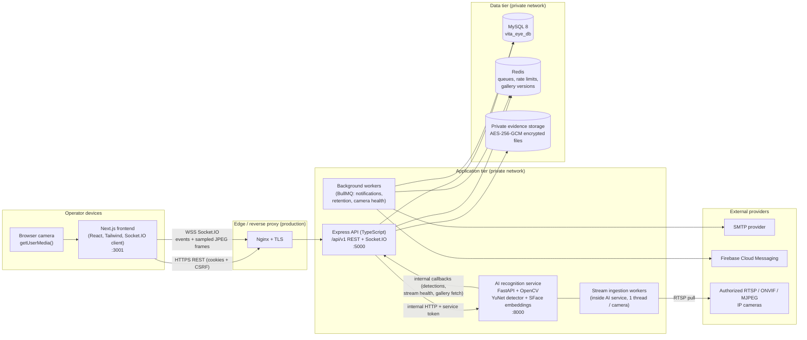
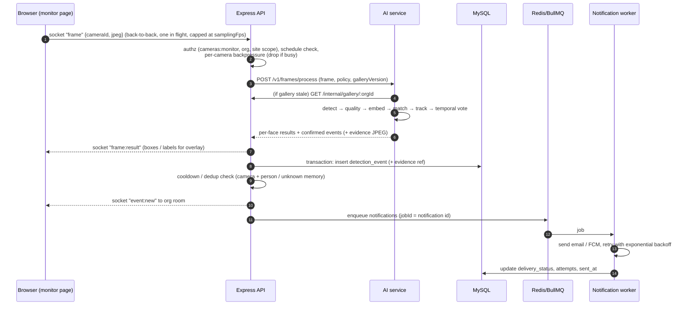

# VITA EYE — System Architecture

> Intelligent Vision. Smarter Security.

## 1. High-level component diagram



## 2. Responsibilities

| Layer | Responsibilities |
|---|---|
| Frontend | Login, dashboard, enrollment with camera capture, live monitoring, alert center, history, notification center, camera/user/settings/audit administration. Never sees RTSP credentials or biometric templates. |
| Backend API | AuthN/AuthZ (JWT in httpOnly cookies, RBAC), org isolation, person & biometric lifecycle, camera configuration (encrypted credentials), ingestion orchestration, detection persistence & dedup, evidence (encrypted, signed URLs), notification orchestration, reports, audit, settings, health. |
| AI service | Face detection (YuNet), quality assessment (size, sharpness, brightness, pose, detector score), 128-d SFace embeddings, cosine matching against an in-memory per-organization gallery, known / unknown / uncertain classification, IoU face tracking + temporal voting, unknown-face memory for duplicate suppression, RTSP/MJPEG stream workers with reconnect/backoff. |
| MySQL | System of record (users, roles, persons, encrypted templates, cameras, events, evidence references, notifications, audit). |
| Redis | BullMQ job queues (notifications with exponential backoff, retention), login rate limiting, per-organization gallery version counters. |

## 3. Recognition data flow



For RTSP/MJPEG cameras the API calls `POST /v1/streams/start` on the AI service with the
decrypted stream URL (over the private network only). The AI stream worker runs the same
pipeline and posts confirmed events to `POST /api/v1/internal/detections` and health to
`POST /api/v1/internal/cameras/:id/status`.

## 4. Classification policy

```
quality < minQuality                     → LOW_QUALITY (ignored, never "unknown")
best similarity ≥ knownThreshold
   and (top1 − top2 other person) ≥ margin → KNOWN candidate
best similarity < unknownThreshold        → UNKNOWN candidate
otherwise                                 → UNCERTAIN candidate
```

A track (same face followed across frames by bounding-box IoU) is only *confirmed* once it
has `temporalMinFrames` usable observations inside `temporalWindowSec`. The confirmed label
is the majority label if it reaches `temporalAgreement` (default 0.7) — otherwise the track is
confirmed as **UNCERTAIN** and routed to human review. Each track emits at most one event.
A very strong single-frame match (≥ `knownThreshold + 0.12`) is confirmed immediately, and a
registered match that leaves the view before the frame quota is finalised from what it collected.
An unrecognized face needs two separate agreeing passes (double verification) before it is
stored, added to the daily tally, or notified. The second pass can still match a registered
person. Leaving before that second pass does not count the face.
Unknown events are additionally suppressed if the embedding matches a recently reported
unknown face on the same camera within the cooldown window; known events are suppressed for
the same person + camera within the cooldown window (enforced in the backend).

Thresholds are per-organization settings and **must be calibrated** on representative
footage for each camera/model (see `docs/AI_CALIBRATION.md`).

## 5. Security architecture

* Passwords: Argon2id. Accounts lock after repeated failures; login is rate-limited (Redis).
* Sessions: short-lived JWT access token + rotating refresh token (hashed in DB), both
  `httpOnly`, `SameSite=Strict`, `Secure` in production. CSRF double-submit token on all
  state-changing requests.
* RBAC enforced in middleware on every route; organization isolation on every query;
  optional site scope per user restricts cameras and their events.
* Biometric templates and camera credentials: AES-256-GCM with versioned key IDs
  (`DATA_ENCRYPTION_KEYS`), envelope encryption via a KMS recommended in production.
  Templates are never returned by public APIs; only the AI service receives decrypted
  embeddings through an internal, token-authenticated endpoint.
* Evidence: encrypted at rest, SHA-256 content hash, retrieved only through short-lived
  HMAC-signed URLs; every access audited.
* SSRF protection: camera hosts must resolve into `CAMERA_ALLOWED_NETWORKS` and outside
  `CAMERA_BLOCKED_NETWORKS` (Docker Compose blocks the stack's own subnets, loopback and
  link-local, so a camera URL can never reach MySQL, Redis or the internal services).
* Key rotation: add a key, make it active, run `npm run keys:rewrap`, then remove the old key
  (see `docs/DEPLOYMENT.md`).
* AI service and internal endpoints are not exposed publicly (Nginx only proxies the
  frontend and `/api/v1` + `/socket.io`; `/api/v1/internal/*` is blocked at the edge).

## 6. Responsible-use constraints

* Results are decision *support*: no door unlocking, accusations or physical interventions
  are triggered by recognition results. UI wording: "Unknown person" (not intruder/criminal).
* Enrollment requires recording the legal basis and consent/notice reference.
* Deletion removes biometric templates immediately; a verified purge job removes the
  soft-deleted person records after the retention period and records an audit entry.
* Assess DPDP Act 2023 and the DPDP Rules with qualified legal counsel before deployment.
