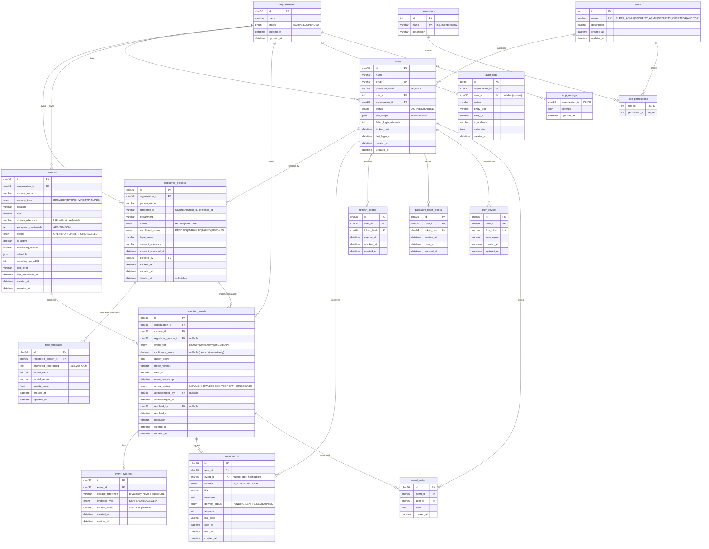

# VITA EYE — MySQL ERD (`vita_eye_db`)

All primary keys are UUID (`CHAR(36)`) unless noted. All tenant-owned tables carry
`organization_id` and every query is scoped by it.

## Key indexes and constraints

| Table | Index / constraint |
|---|---|
| users | `UNIQUE(email)`, `IDX(organization_id)` |
| registered_persons | `UNIQUE(organization_id, reference_id)`, `IDX(organization_id, enrollment_status)` |
| face_templates | `IDX(registered_person_id)`, FK `ON DELETE CASCADE` |
| cameras | `IDX(organization_id, status)` |
| detection_events | `IDX(organization_id, event_timestamp)`, `IDX(camera_id, event_timestamp)`, `IDX(organization_id, event_type, event_timestamp)`, `IDX(organization_id, review_status)`, `IDX(registered_person_id)` |
| event_evidence | `IDX(event_id)`, `IDX(expires_at)` |
| notifications | `UNIQUE(event_id, user_id, channel)` (duplicate-alert guard), `IDX(user_id, created_at)` |
| audit_logs | `IDX(organization_id, created_at)`, `IDX(entity_type, entity_id)` |

## Retention & deletion

| Data | Default retention | Mechanism |
|---|---|---|
| Face templates | Until person deleted / revoked | Hard-deleted in the same transaction as person deletion |
| Soft-deleted persons | 30 days | `retention` job hard-deletes and verifies zero templates remain (`BIOMETRIC_PURGE_VERIFIED` audit) |
| Evidence | 30 days (`evidenceRetentionDays`) | `expires_at`; retention job deletes file + row |
| Detection events | 365 days | Retention job |
| Notifications | 90 days | Retention job |
| Audit logs | 730 days | Retention job |

All retention periods are per-organization settings.
